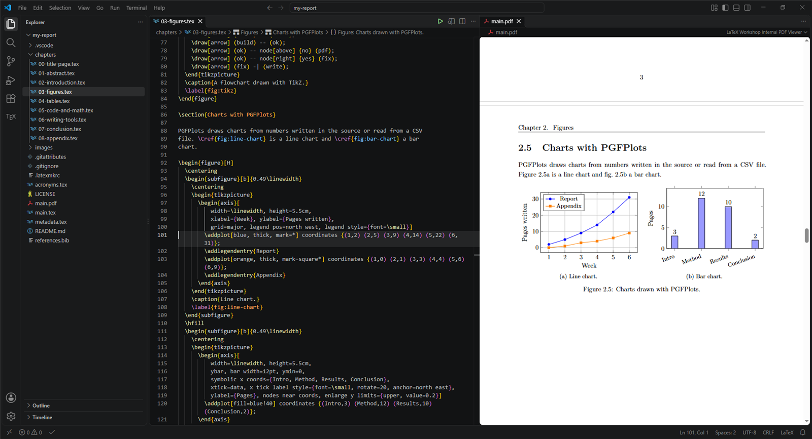
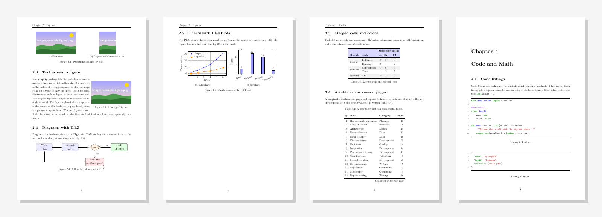
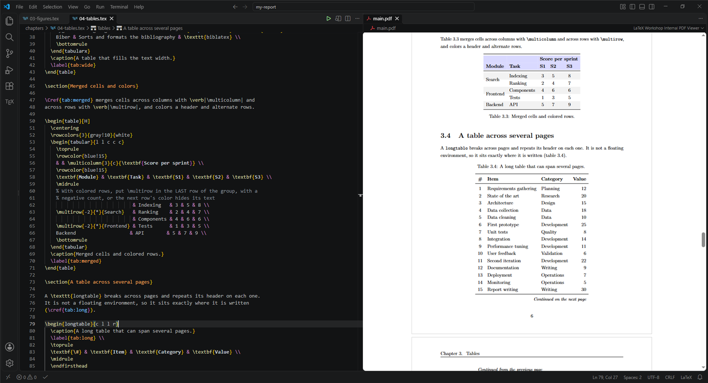

<p align="center">
  
</p>

<h1 align="center">LocalLeaf</h1>

<p align="center"><b>Overleaf, but local, in VS Code. Batteries included.</b></p>

Write LaTeX in VS Code with everything you liked about Overleaf: the PDF rebuilds on every save and sits next to your source, double-click in the PDF jumps to the matching line, and bibliography and cross references just work. No internet, no compile timeout, your files stay in Git.

One command installs the toolchain on **Windows** or **Linux** and creates a ready-to-fill report.



## Quick start

### Requirements

- **[Visual Studio Code](https://code.visualstudio.com/download)**
- The **[LaTeX Workshop](https://marketplace.visualstudio.com/items?itemName=James-Yu.latex-workshop)** extension: install it from the Extensions view (**Ctrl+Shift+X**, search "LaTeX Workshop"), or run `code --install-extension james-yu.latex-workshop`

The setup script below installs everything else (the TeX distribution, Perl, ...). Open a terminal in the folder where you keep your projects and run the command for your system:

**Windows** (PowerShell):

```powershell
irm https://raw.githubusercontent.com/Ghorbel37/LocalLeaf/example/setup.ps1 | iex
```

**Linux** (bash):

```bash
curl -fsSL https://raw.githubusercontent.com/Ghorbel37/LocalLeaf/example/setup.sh | bash
```

It guides you through everything: it asks for your report name and which template you want (empty, full example or ENIS), checks what is installed, asks before installing anything missing, creates the project folder and opens it in VS Code. Then open the main `.tex` file and press **Ctrl+Alt+B**.

### Options

To skip the questions or use the script in your own scripts, pass options:

```powershell
iex "& { $(irm https://raw.githubusercontent.com/Ghorbel37/LocalLeaf/example/setup.ps1) } -Init my-report -Example"
```

```bash
curl -fsSL https://raw.githubusercontent.com/Ghorbel37/LocalLeaf/example/setup.sh | bash -s -- --init my-report --example
```

| Windows | Linux | Effect |
|---|---|---|
| `-Init [NAME]` | `--init [NAME]` | Create a project in the folder `NAME` and open it in VS Code. Without `NAME`, the script asks for it |
| `-Example` | `--example` | With init, start from the example report instead of the empty one |
| `-Enis` | `--enis` | With init, start from the ENIS graduation report template |
| `-CheckOnly` | `--check` | Only report what is installed, change nothing |
| `-Yes` | `--yes` | Install everything missing without asking |
| `-Test` | `--test` | Build `main.tex` at the end to prove everything works |

Leave out the init option to only install the tools. The Windows script installs with [winget](https://learn.microsoft.com/windows/package-manager/winget/), which ships with Windows 10 and 11, and tells MiKTeX to download missing LaTeX packages automatically. The Linux script works with apt (Debian, Ubuntu, Mint), dnf (Fedora) and pacman (Arch, Manjaro), and uses `sudo` for the packages.

## Three flavors

| Branch | What's inside | Pick it if |
|---|---|---|
| [`main`](../../tree/main) | The VS Code config, a `.gitignore` and the report structure **with empty chapters**. | You want a clean start (this is what **Use this template** gives you) |
| [`example`](../../tree/example) | A **full example report** (about 20 pages): images, subfigures, TikZ diagrams and charts, merged, colored and multi-page tables, highlighted code (`minted`), equations and theorems, citations, acronyms, footnotes and colored boxes. Also holds the setup scripts | You want to see what it can do, or keep the examples at hand while writing |
| [`enis`](../../tree/enis) | The ENIS (National Engineering School of Sfax) graduation report template by [Jacem Chaieb](https://github.com/kidager/enis-report-latex), with the LocalLeaf setup | You are writing an ENIS graduation report |

Without the setup script: click **Use this template** for `main`, or clone a flavor with `git clone -b example https://github.com/Ghorbel37/LocalLeaf.git`, or download the [`main`](../../archive/refs/heads/main.zip), [`example`](../../archive/refs/heads/example.zip) or [`enis`](../../archive/refs/heads/enis.zip) ZIP.



## What's in a project

| File | What it does |
|---|---|
| [`.vscode/settings.json`](.vscode/settings.json) | LaTeX Workshop config: build with `latexmk` on save, SyncTeX (double-click in the PDF jumps to the source), PDF preview in a tab |
| [`.vscode/extensions.json`](.vscode/extensions.json) | VS Code offers to install LaTeX Workshop when you open the folder |
| [`main.tex`](main.tex) | Report structure: packages, page style, document outline |
| [`metadata.tex`](metadata.tex) | Title, author, institution, supervisor, date: edit this first |
| [`chapters/`](chapters/) | Title page, abstract, introduction, conclusion, appendix |
| [`acronyms.tex`](acronyms.tex) | Acronym list, printed automatically |
| [`references.bib`](references.bib) | Bibliography |
| [`images/`](images/) | Your figures |
| [`.gitignore`](.gitignore) | Ignores every LaTeX build file (`.aux`, `.log`, `.synctex.gz`, ...) |

## Manual installation

Prefer to install things yourself? The only real difference between the two systems is that Windows needs MiKTeX and Strawberry Perl, while Linux uses TeX Live and already has Perl.

| Tool | Why | Windows | Linux |
|---|---|---|---|
| VS Code | The editor | [Download](https://code.visualstudio.com/download) | [Download](https://code.visualstudio.com/download) |
| TeX distribution | `pdflatex`, `latexmk`, `biber` and the LaTeX packages | [MiKTeX](https://miktex.org/download) | [TeX Live](https://tug.org/texlive/), from your package manager (see below) |
| Perl | `latexmk` is a Perl script | [Strawberry Perl](https://strawberryperl.com/) | Already installed |
| LaTeX Workshop | VS Code extension: build, preview, SyncTeX, autocompletion | [Marketplace](https://marketplace.visualstudio.com/items?itemName=James-Yu.latex-workshop) | [Marketplace](https://marketplace.visualstudio.com/items?itemName=James-Yu.latex-workshop) |
| Pygments | Only for the `example` and `enis` branches, and only with an older `minted` (see [minted troubleshooting](#minted-troubleshooting)) | [uv](https://docs.astral.sh/uv/getting-started/installation/), then `uv tool install pygments` | `python3-pygments` from your package manager |

**Windows:** after installing MiKTeX, open the **MiKTeX Console**, go to **Settings** and set "Install missing packages on-the-fly" to **Always**. Install Strawberry Perl after MiKTeX and restart VS Code so it finds both.

**Linux packages:**

```bash
# Debian, Ubuntu, Mint
sudo apt install texlive-latex-extra texlive-fonts-recommended texlive-bibtex-extra lmodern latexmk biber

# Fedora
sudo dnf install texlive-scheme-medium texlive-acro texlive-biblatex latexmk biber

# Arch, Manjaro
sudo pacman -S texlive-basic texlive-latex texlive-latexrecommended texlive-latexextra texlive-fontsrecommended texlive-bibtexextra texlive-pictures texlive-binextra biber
```

Want every LaTeX package at once? Install `texlive-full` (Debian, Ubuntu), `texlive-scheme-full` (Fedora) or `texlive` (Arch). It is several GB.

## Using it

### In VS Code



| Shortcut | Action |
|---|---|
| **Ctrl+S** | Save and rebuild |
| **Ctrl+Alt+B** | Build manually |
| **Ctrl+Alt+V** | Open the PDF preview |
| **Double-click in the PDF** | Jump to the matching line in the source |
| **Ctrl+Alt+J** in the source | Jump to the matching place in the PDF |

The TeX icon in the sidebar shows the document outline, the build recipes and the error list. Two recipes are available: `latexmk (pdflatex)` (default, runs as many passes as needed, bibliography included) and `pdflatex (single pass)` (quick rebuild).

### From a terminal

```bash
latexmk -pdf main.tex    # build
latexmk -c               # remove build files, keep the PDF
latexmk -C               # remove build files and the PDF
```

### Making it yours

- Fill in [`metadata.tex`](metadata.tex). To show a logo on the title page, put it in `images/` and set `\reportLogo`.
- Each chapter is a file in [`chapters/`](chapters/), included from `main.tex` with `\input{chapters/...}`. Add, remove or rename them freely.
- Need an example of a figure, table, equation or citation? See the [chapters of the example report](../../tree/example/chapters).
- For a French report, change `\usepackage[english]{babel}` to `\usepackage[french]{babel}` in `main.tex`.
- The `example` branch builds with `-shell-escape`, because `minted` needs it to call its highlighter. Only build documents you trust with it.

## Troubleshooting

| Problem | Fix |
|---|---|
| `latexmk` cannot find Perl (Windows) | Install [Strawberry Perl](https://strawberryperl.com/), then restart VS Code |
| `File 'xyz.sty' not found` (Linux) | Install the missing package, or `texlive-full` to never see this again |
| Citations show as **[?]** or bold keys | Build again with `latexmk`, it runs Biber for you |
| A tool was just installed but VS Code does not see it | Close every VS Code window and reopen it so it picks up the new PATH |
| MiKTeX opens a popup for each package | Run `initexmf --set-config-value [MPM]AutoInstall=1`, or set it in the MiKTeX Console |
| Any `minted` error | See [minted troubleshooting](#minted-troubleshooting) below |

### minted troubleshooting

> [!WARNING]
> `minted` (code highlighting in the `example` and `enis` flavors) breaks more often than any other package, because it calls an external program while LaTeX runs. The setup script compiles a small test document with `minted` and warns you if it fails. If you get stuck, go through these steps in order.

1. **"You must invoke LaTeX with the -shell-escape flag".** Build with the provided recipe (**Ctrl+Alt+B**) or with `latexmk`: both pass `-shell-escape`. If you build any other way, add `-shell-escape` yourself.
2. **Know which minted you have.** Open the `.log` file and search for `Package: minted`.
   - **minted 3** (2024 and later, any up-to-date MiKTeX or TeX Live) calls `latexminted`, which comes with the TeX distribution and already includes Pygments. Check it with `latexminted --version`.
   - **minted 2** (older distributions, such as the TeX Live of Ubuntu 22.04) calls `pygmentize`, which you install yourself. Check it with `pygmentize -V`.
3. **"minted v3+ executable is not installed or is not added to PATH".** Update your distribution so `latexminted` is there: MiKTeX Console > **Updates** > **Update now** on Windows, `sudo tlmgr update --self --all` for a TeX Live installed from tug.org. On TeX Live, `latexminted` also needs Python 3.
4. **Errors about `pygmentize` (minted 2).** Install Pygments: `uv tool install pygments` on Windows, `python3-pygments` on Linux. Then check that `pygmentize -V` works in a **new** terminal.
5. **It works in a terminal but not in VS Code.** VS Code keeps the PATH it had when it started. Close every VS Code window (on Windows, also check the system tray) and open it again.
6. **Still the old error after fixing something.** Delete the `_minted` folder next to your `.tex` file and build again: it caches results from earlier runs.
7. **Something else.** Open the `.log` file and look for the first line that starts with `!`. That line is the real error, the rest usually follows from it.

## Useful links

- [LaTeX Workshop wiki](https://github.com/James-Yu/LaTeX-Workshop/wiki)
- [Overleaf's LaTeX guides](https://www.overleaf.com/learn), still the best place to learn LaTeX
- [biblatex](https://ctan.org/pkg/biblatex), [acro](https://ctan.org/pkg/acro), [listings](https://ctan.org/pkg/listings), [minted](https://ctan.org/pkg/minted) and [latexmk](https://ctan.org/pkg/latexmk) documentation

## Support

If LocalLeaf helped you, a star or a mention is appreciated.

## License

[MIT](LICENSE)
